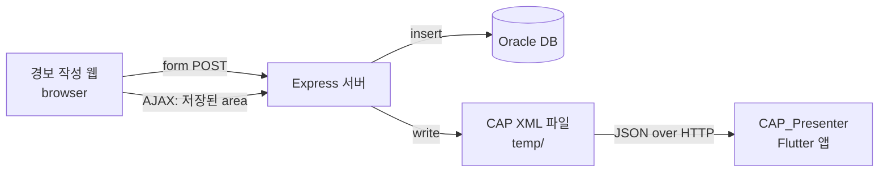

# CAP_System

[English](README.md) | **한국어**

재난경보 국제 XML 표준인 **CAP(Common Alerting Protocol)** 기반 재난경보 시스템의 경보 작성 웹과 웹서버입니다.

2020년 9월부터 12월까지 서울시립대학교 소프트웨어시스템실습 과목에서 한 학기 동안 수행한 개인 프로젝트입니다. 경보를 표출하는 모바일 앱은 [CAP_Presenter](https://github.com/Minchan6847/CAP_Presenter)에 있습니다.

## 기능



**작성 웹 (frontend)**

- CAP 메시지 구조 순서대로 Header, Info, Resource, Area 4개 화면으로 구성했습니다. Previous, Next 버튼으로 이동하며, CAP의 모든 요소에 입력란이 있습니다.
- Resource: 이미지나 오디오 파일을 선택하면 브라우저에서 base64로 encoding해 `derefUri` 요소에 자동 입력하고 미리보기를 보여줍니다.
- Area: Leaflet 지도에 polygon이나 circle로 피해 지역을 그리면 좌표가 입력란에 채워집니다.
- 목록에서 기존 경보를 클릭하면 그 polygon과 circle을 지도에 다시 불러와, 이전 지역 정보를 재사용할 수 있습니다.

**서버 (backend)**

- area 정보를 Oracle DB에 insert합니다.
- 평면적인 form 항목을 CAP의 계층 구조(`alert` > `info` > `resource`, `area`)로 다시 묶고, 빈 항목을 제외한 뒤 CAP XML 파일을 `temp/`에 저장합니다.
- 저장된 모든 XML 파일을 JSON으로 묶어 모바일 앱에 전달합니다.

## Route

| Route | Method | 동작 |
|---|---|---|
| `/area` | GET | DB에 저장된 경보 목록과 함께 작성 웹을 표시 |
| `/send` | POST | 제출된 경보를 DB와 XML 파일로 저장한 뒤 작성 웹으로 복귀 |
| `/ajax` | POST | 저장된 경보 하나의 polygon과 circle을 반환 |
| `/flutterTest` | GET | `temp/`의 모든 XML 파일을 앱용 JSON 배열로 반환 |

## 구조

| 경로 | 내용 |
|---|---|
| `app.js`, `bin/www` | Express application과 시작 script |
| `routes/` | 위 표의 route handler |
| `views/` | EJS template. `area.ejs`가 작성 웹입니다. |
| `db/db_conn.js` | DB insert, form을 CAP 구조로 변환 |
| `db/dbCofig.js` | DB 접속 설정 |
| `data/js2xml.js` | `js2xmlparser`로 CAP object를 XML 파일로 저장 |
| `public/` | style, 이미지, Leaflet과 Leaflet.draw source |
| `temp/` | 생성된 CAP XML 파일 (sample 포함) |

## 사용 기술

Node.js, Express, EJS, node-oracledb, js2xmlparser, Leaflet, Leaflet.draw, jQuery, Bootstrap.

Ubuntu 20.04의 Oracle Database 11g Express Edition을 대상으로 개발했고, 웹서버는 macOS에서 실행했습니다.

## 실행

1. Node.js와 `node-oracledb`에 필요한 Oracle Instant Client를 설치합니다.
2. `area` table을 만듭니다. column은 순서대로 8개입니다: 파일 이름, area 설명, polygon, circle, geocode value name, geocode value, altitude, ceiling.
3. `db/dbCofig.js`에 본인의 접속 설정을 넣습니다.
4. 설치하고 시작합니다.

```bash
npm install
npm start
```

5. <http://localhost:3000/area>를 엽니다.

## 보고서

최종보고서는 포트폴리오의 프로젝트 페이지에 연결되어 있습니다: <https://minchan6847.github.io/#ko-cap>.
