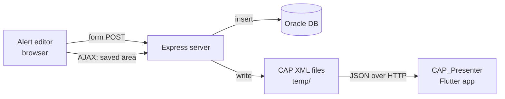

# CAP_System

**English** | [한국어](README.ko.md)

Web editor and server of a disaster alert system built on the **Common Alerting Protocol (CAP)**, the international XML standard for emergency alerts.

Solo semester project for the Software System Lab course at the University of Seoul, September to December 2020. The mobile app that displays the alerts is in [CAP_Presenter](https://github.com/Minchan6847/CAP_Presenter).

## What it does



**Editor (frontend)**

- Four screens in the order of a CAP message: Header, Info, Resource, Area. Previous and Next buttons move between them, and every CAP element has an input.
- Resource: choosing an image or audio file encodes it to base64 in the browser, fills the `derefUri` element and shows a preview.
- Area: the affected region is drawn on a Leaflet map as a polygon or a circle, and the coordinates fill the form.
- Clicking a saved alert in the list loads its polygon and circle back onto the map, so an earlier area can be reused.

**Server (backend)**

- Inserts the area record into an Oracle database.
- Rebuilds the flat form fields into the nested CAP structure (`alert` > `info` > `resource`, `area`), drops empty fields and writes a CAP XML file to `temp/`.
- Serves all stored XML files as JSON for the mobile app.

## Routes

| Route | Method | What it does |
|---|---|---|
| `/area` | GET | Renders the editor with the list of saved alerts from the database |
| `/send` | POST | Stores the submitted alert in the database and as an XML file, then returns to the editor |
| `/ajax` | POST | Returns the polygon and circle of one saved alert |
| `/flutterTest` | GET | Returns every XML file in `temp/` as a JSON array for the app |

## Structure

| Path | Contents |
|---|---|
| `app.js`, `bin/www` | Express application and start script |
| `routes/` | Route handlers listed above |
| `views/` | EJS templates. `area.ejs` is the editor. |
| `db/db_conn.js` | Database insert and conversion of the form into the CAP structure |
| `db/dbCofig.js` | Database connection settings |
| `data/js2xml.js` | Writes the CAP object as an XML file with `js2xmlparser` |
| `public/` | Styles, images, and the Leaflet and Leaflet.draw sources |
| `temp/` | Generated CAP XML files (samples included) |

## Built with

Node.js, Express, EJS, node-oracledb, js2xmlparser, Leaflet, Leaflet.draw, jQuery, Bootstrap.

Developed against Oracle Database 11g Express Edition on Ubuntu 20.04, with the web server on macOS.

## Run

1. Install Node.js and the Oracle Instant Client that `node-oracledb` needs.
2. Create the `area` table. It has eight columns.

### `area` Table

Stores area data submitted from the form in [`views/area.ejs`](views/area.ejs), received by [`routes/send.js`](routes/send.js) (`POST /`), and inserted via [`db/db_conn.js`](db/db_conn.js) in the order of the `sending_data` array.

| Column | Data Type | Nullable | Payload Field (`sending_data`) |
| :--- | :--- | :---: | :--- |
| `FILE_NAME` | `VARCHAR2(255)` | `NOT NULL` | `data.file_name` |
| `AREA_DESC` | `VARCHAR2(300)` | `NOT NULL` | `data.areaDesc` |
| `POLYGON` | `VARCHAR2(300)` | Yes | `data.capPolygon` |
| `CIRCLE` | `VARCHAR2(200)` | Yes | `data.capCircle` |
| `GEOCODE_VALUE_NAME` | `VARCHAR2(30)` | Yes | `data.geocodeValueName` |
| `GEOCODE_VALUE` | `NUMBER(38)` | Yes | `data.geocodeValue` |
| `ALTITUDE` | `NUMBER(38)` | Yes | `data.altitude` |
| `CEILING` | `NUMBER(38)` | Yes | `data.ceiling` |

#### Table Creation (Oracle DB Server)

Because the Oracle database server is separate from the web server, create the `area` table in the target schema first before processing `INSERT` requests. On the web server, install dependencies and start the app with `npm install` and `npm start`.

```sql
CREATE TABLE area (
  FILE_NAME          VARCHAR2(255) NOT NULL,
  AREA_DESC          VARCHAR2(300) NOT NULL,
  POLYGON            VARCHAR2(300),
  CIRCLE             VARCHAR2(200),
  GEOCODE_VALUE_NAME VARCHAR2(30),
  GEOCODE_VALUE      NUMBER(38),
  ALTITUDE           NUMBER(38),
  CEILING            NUMBER(38)
);
```

3. Put your own connection settings in `db/dbCofig.js`.
4. Install and start:

```bash
npm install
npm start
```

5. Open <http://localhost:3000/area>.

## Report

The final report (in Korean) is linked from the project page on my portfolio: <https://minchan6847.github.io/#cap>.
